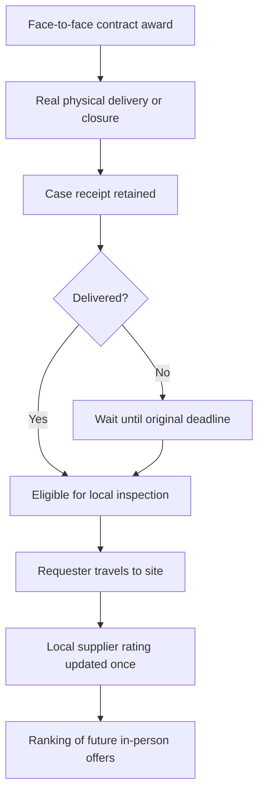

# Sealed Heaven C2.1 — Institutional Accountability

## Delivery status

**Compiled on Windows, 20 November 2026.** Built from the user-supplied,
Windows-tested C2.0 source archive. C2.0's original rules and checkpoint
revision remain present. The deterministic C0.1 kernel (`src/` outside the
living campaign) is untouched.

Windows gate on rustc 1.100.0: `cargo fmt --all -- --check` and the playable
manifest check are clean. `cargo test --manifest-path Cargo.toml living::`
passed 103 tests, including the 13 new revision-12 memory tests and
`v12_replays_canonical_worlds_and_keeps_v11_campaign_exact`.
`cargo test --manifest-path apps/sealed_playable/Cargo.toml --no-default-features`
passed 77 tests (46 library, including `c21_accountlog_is_witness_only_localized_and_read_only`
and `c21_seeding_reset_and_c20_legacy_keep_distinct_save_revisions`, plus 6 adapter,
9 agency, 3 clock, 9 supply, 2 conflict, 2 memory). `cargo clippy --all-targets -D warnings`
is clean for `sealed_sim` and `sealed_playable`. Scripted `sealed_agency` on seed 1
and seed 2 shows `contractlog` / `accountlog` in English and Indonesian, including
"No witnessed contract audits." and "Belum ada pemeriksaan kontrak yang kamu saksikan."
`--c20` stays on the C2.0 contract campaign. A five-minute human playtest was not done.

### Design purpose

C2.0 created real-world contracts. C2.1 makes those agreements matter after
they finish. A village or school can learn whether a supplier is dependable,
but only when its requester visits the delivery site and checks the record.
This is not a universal goodwill meter: two institutions can disagree about the
same supplier based on their own experiences.

This is a focused, general-purpose engine change; both Qinghe medicine and Reed
Hall offerings use the same accounting protocol. ASCII remains the primary
turn-based client. No network calls, random inference, clocks or LLMs are
involved in simulation decisions.

## Canonical rules (revision 12)

1. A contracted provider must first receive an **in-person confirmed award**.
   Mere selection of a bid during the requester's travels is not liability.
2. A closed, confirmed agreement creates a case-numbered local receipt. A
   delivery leaves affirmative evidence at its destination. Failure elsewhere
   does *not* broadcast the provider's fate to the requester.
3. An unfinished job may only be assessed once its **original deadline** has
   elapsed (480 ticks from opening). The finding is strictly “no signed
   delivery by deadline”, not “the provider was killed”, “deserted”, etc.
4. The requester must personally visit the relevant site, within physical
   interaction range and unobstructed vision, before the receipt becomes a
   learned outcome. Only living, unaccompanied requesters perform audits.
5. Confirmed delivery adds **+2** to that requester's reliability estimate for
   the provider. A missed deadline subtracts **3**. Scores are clamped to
   **[-6, +6]**. Inspecting the same receipt twice never applies a second score.
6. Later offers still require the C2.0 face-to-face solicitation and award.
   Bid ranking combines the original personal social regard with that
   requester's independently acquired reliability estimate, before considering
   price and stable tie breakers. A negative score never creates cargo or
   automatically prevents an offer; alternate suppliers can win.
7. Contract accounts hold at most **96** receipts and **160** witnessed or
   unwitnessed historical audit events. Already-inspected entries are pruned
   first. The limit keeps 65,536-turn campaigns bounded. No secret state is
   erased from ongoing market stocks, completed totals or personal scores.
8. The player only reads **physically witnessed** audit events in `accountlog`;
   it never exposes private receipts or ratings from distant institutions.
   Inspection commands and language changes do not advance time.

## Consequence sequence



The receipt is simulation state, not an NPC's telepathic knowledge. Remote
closures can be tracked mechanically so the contract engine knows it no longer
holds a provider, while the local actor remains uninformed until inspection.

## Persistence and legacy contract

- New rules: `World::contract_accountability(seed)`, `SH:C10:WORLD` **revision
  12**, scenario fingerprint `SH:C10:RULES:v12`, state fingerprint
  `SH:C10:STATE:v12`.
- Revision-12 digest includes every receipt, review flag, personal rating and
  audit event. Checkpoints remain event-sourced: load replays canonical intents
  and verifies the result against that complete state digest.
- Revision-11 `World::institutional_agency(seed)` is unchanged in gameplay:
  receipt storage and audit goals are absent; bid-ranking addition is zero.
  `--c20` uses the old `checkpoint.c20` path. Its old fingerprint, goal IDs
  and checkpoint serialization are preserved.
- C1.9 (`--c19`) and older paths do not gain contract memory or silently
  upgrade on seed/reset or replay.
- New default ASCII campaign: **revision 12**, `checkpoint.c21`; `--c20`
  explicitly starts C2.0 revision 11.

## Player controls

```text
cargo run --manifest-path apps/sealed_playable/Cargo.toml --bin sealed_agency --no-default-features
cargo run --manifest-path apps/sealed_playable/Cargo.toml --bin sealed_agency --no-default-features -- --c20
```

- `n` or `wait`: one canonical turn (NPC audits happen on the same tick).
- `contractlog`: C2.0 contract activity actually witnessed by the player.
- `accountlog`: new physically witnessed audits and their verdicts.
- `lang id`: Indonesian interface; `lang en`: English.
- `seed 1`: alternate authored road, before taking the first turn.
- `v`, `o`, `r`: save, load and reset within the active campaign revision.
- For scripted smoke runs, `SEALED_ASCII_COMMANDS` accepts the original
  semicolon-separated commands or single-token movement scripts.

## Acceptance gates

| Gate | Expected result | Current verification |
| --- | --- | --- |
| Historical C2.0 fixtures | Revision-11 saves and C2.0 behavior unchanged | `v12_replays_canonical_worlds_and_keeps_v11_campaign_exact` and the C2.0 ASCII isolation test passed |
| Both routes, revision-12 replay | Save/load and continued turns remain byte-stable | Passed in the living suite on 20 November 2026 |
| No remote omniscience | Receipt alone does not update trust | Passed in the living suite |
| Delayed missed deadlines | Early death/withdrawal does not immediately reveal an outcome | Passed in the living suite |
| Award integrity | Unconfirmed candidate and providerless failure create no culpability | Passed in the living suite |
| Consequential future bids | Requester's verified rating alters next award | Passed in the living suite |
| Material conservation | Ratings never mint a herb, grant money, or shortcut meeting | Passed with the existing C2.0 contract tests |
| NPC death, duplicates, storage bounds | No auditing by dead requester, no duplicate credit, bounded logs | Passed in the living suite |
| ASCII language, privacy, read-only | `accountlog` EN/ID, no unseen verdict, no tick consumed | Both new client tests passed; scripted seed 1 and seed 2 confirmed |
| Rustfmt, Clippy, 5-minute human test | Clean and playable on Windows | Rustfmt and Clippy are clean. Human playtest not done |

Suggested native commands:

```powershell
cargo fmt --all -- --check
cargo test --lib living::
cargo test --manifest-path apps/sealed_playable/Cargo.toml --no-default-features
cargo clippy --lib -- -D warnings
cargo clippy --manifest-path apps/sealed_playable/Cargo.toml --no-default-features -- -D warnings
```

If Rustfmt reports formatting differences, use `cargo fmt --all` before
rerunning the gates. The Windows gate above is the compiled baseline. It does
not replace a human playtest.

## Known limits and future work

- The first version audits original deadlines and signed deliveries, not
  misconduct attribution or appeal testimony. False accusations, adversarial
  paper records and forged receipts are **not** simulated.
- Personal institutional trust does not propagate through the generic social
  gossip network. A future stage can introduce **physical testimony** with
  provenance and disputes without granting shared omniscience.
- Bound receipt eviction can drop an old unreviewed case in very long campaigns;
  ratings already learned are retained. This is intentional retention policy.
- Navigation through one-tile traffic bottlenecks and human play feel still
  require testing. A successful Rust test gate does not replace a human playtest.
